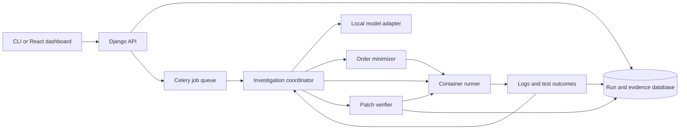

# Wobble architecture

## Goal

Find and repair flaky pytest tests with a local open-weight model. Every claim about a fix must come from executed tests. The model chooses experiments and proposes patches. The runner and verifier decide what happened.

## Target design

The Python core owns collection, experiments, statistics, minimization, model actions, and verification. Django exposes jobs and stored evidence. Celery runs long jobs outside web requests. React shows progress and evidence. The web components call the core; they do not contain diagnosis rules. Use SQLite for a local demo. Add PostgreSQL when jobs need concurrent writers.

## Contracts

1. **Runner:** Accept a repository revision, an ordered list of pytest node IDs, run conditions, and a time limit. Run in a disposable container. Return the executed order, result of each test, exit code, observed wall clock, and duration. Treat an incomplete run as a harness error.
2. **Hunter:** Select experiments and repeat them. Store the seed and conditions for every run. Report passes, failures, skips, failure rate, and a Wilson interval for each test. Mark a test "observed flaky" only after it both passes and fails.
3. **Minimizer:** Replay the failing prefix with the victim last. Use ddmin to remove earlier tests. Require repeated confirmation. Return a 1-minimal prefix or an inconclusive result when the failure cannot be reproduced.
4. **Model coordinator:** Give a local open-weight model the compact evidence and a fixed menu of actions, such as `run_isolated`, `reorder`, and `shift_clock`. Validate its structured response. Execute actions through the runner. Limit steps, time, and compute. The model can classify a cause and propose a patch only after it has evidence.
5. **Verifier:** Apply a proposed patch in a disposable copy. Reject patches that remove tests or assertions. Run the original reproducer, the full suite, and a fixed budget of perturbation runs. Store every result. Mark a patch verified only if all required runs pass. A pass in 100 runs is evidence, not proof that the failure rate is zero.
6. **Comparison:** Run a deterministic baseline on the same cases. Compare its verified repair rate with the model-guided rate. This measures whether the model contributes to the result.

## Build order

| Stage | Deliverable | Gate |
| --- | --- | --- |
| 1. Core hunt | pytest collection, subprocess reruns, order shuffle, per-test statistics, ddmin, JSON evidence | Demo polluter and victim are found and reduced. **Implemented.** |
| 2. Isolation | Docker runner, CPU and memory limits, clock shift, run timeout | The demo repository remains unchanged across isolated runs. **Implemented.** |
| 3. Model loop | Local Ollama adapter, strict action schema, short evidence, retry and step budgets | Implemented. The selected model produced a supported shared-state diagnosis on the demo. |
| 4. Repair | Patch proposal, assertion checks, verification suite, baseline comparison | Implemented in the CLI. Qwen3 4B Instruct verified three prepared fixes and one holdout fix with 100 Docker reruns each. |
| 5. Web | Django API, persistent jobs, Celery and Redis, React dashboard | A user can start and inspect a hunt without a terminal. |

The CLI is the fallback demo at every stage. The web layer comes after the investigation and repair loop works.

## Current limits

The local runner starts a fresh Python process for each run. It does not provide a security boundary. Use it only on code you trust. The Docker runner mounts the target repository read only, disables networking, drops Linux capabilities, and limits CPU, memory, and process count. It still relies on the Docker daemon and host configuration. Do not claim that it can safely execute arbitrary hostile code.

The default Docker image contains pytest and `libfaketime`. A target project may need a custom image with its own dependencies. A clock shift affects programs that use the intercepted time functions; it may not affect direct kernel calls or static binaries. The hunter currently uses shuffled order and one fixed CPU and clock profile per hunt. The model can select a small set of follow-up experiments, but its diagnosis is only a hypothesis. The repair loop accepts one bounded insertion per attempt and sends failed results back to the model. Its deterministic baseline covers one module-dictionary pattern. The verifier uses the saved run conditions. It requires the victim test function and existing assertion expressions to remain unchanged, but this cannot prove that a test kept its meaning. The prepared cases show a model advantage over the baseline, but they do not establish general repair quality. Parallel execution remains future work.
